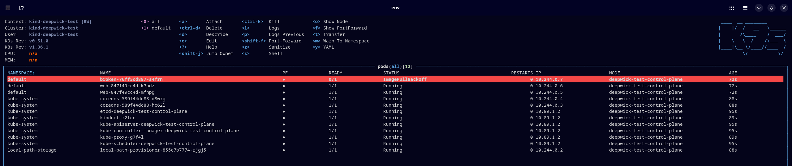

# Deepwick for k9s

Deepwick skin for [k9s](https://k9scli.io).

> Deepwick is an unofficial theme derived from
> [Polywick Blue](https://vscode.polywickstudio.net) by Polywick Studio (MIT).
> Not affiliated with Polywick Studio.



## Install

```sh
mkdir -p "${XDG_CONFIG_HOME:-$HOME/.config}/k9s/skins"
cp deepwick.yaml "${XDG_CONFIG_HOME:-$HOME/.config}/k9s/skins/"
```

If you set `K9S_CONFIG_DIR`, use `$K9S_CONFIG_DIR/skins` instead; `k9s info`
shows the directory k9s reads.

## Activate

In k9s's `config.yaml`:

```yaml
k9s:
  ui:
    skin: deepwick
```

Or per run: `K9S_SKIN=deepwick k9s`.

## Notes

- Focused borders and the logo Blue, other borders Overlay, crumbs Background
  on Blue, cursor row on Selection.
- Resource status: ordinary rows Foreground (k9s's `newColor`), modified Blue, added Green, pending Yellow,
  errors and killed Red, completed Muted.
- Flash messages and a few tree/graph glyphs use colors fixed by k9s.
- Inside tmux, k9s rounds skin colors to the 256-color palette, so they are
  close to Deepwick's rather than exact.

Tested with k9s 0.51.0.

## License

MIT. See [LICENSE](LICENSE).
